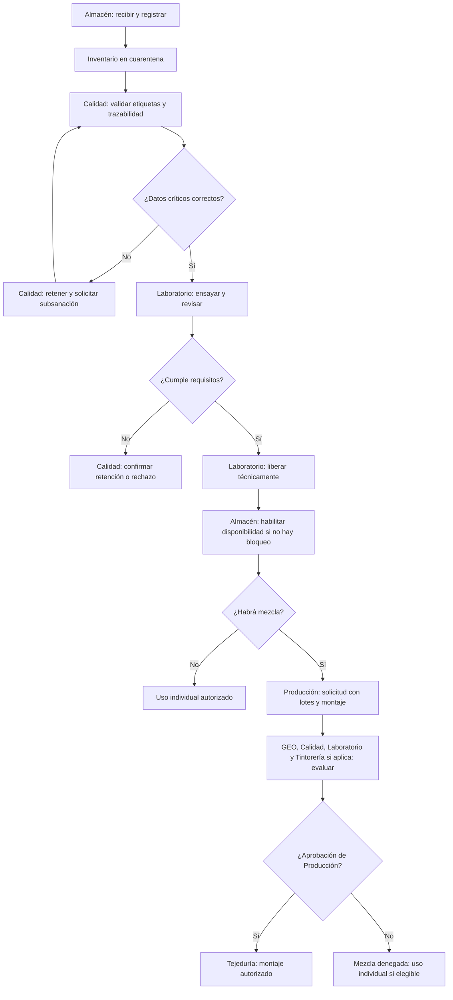
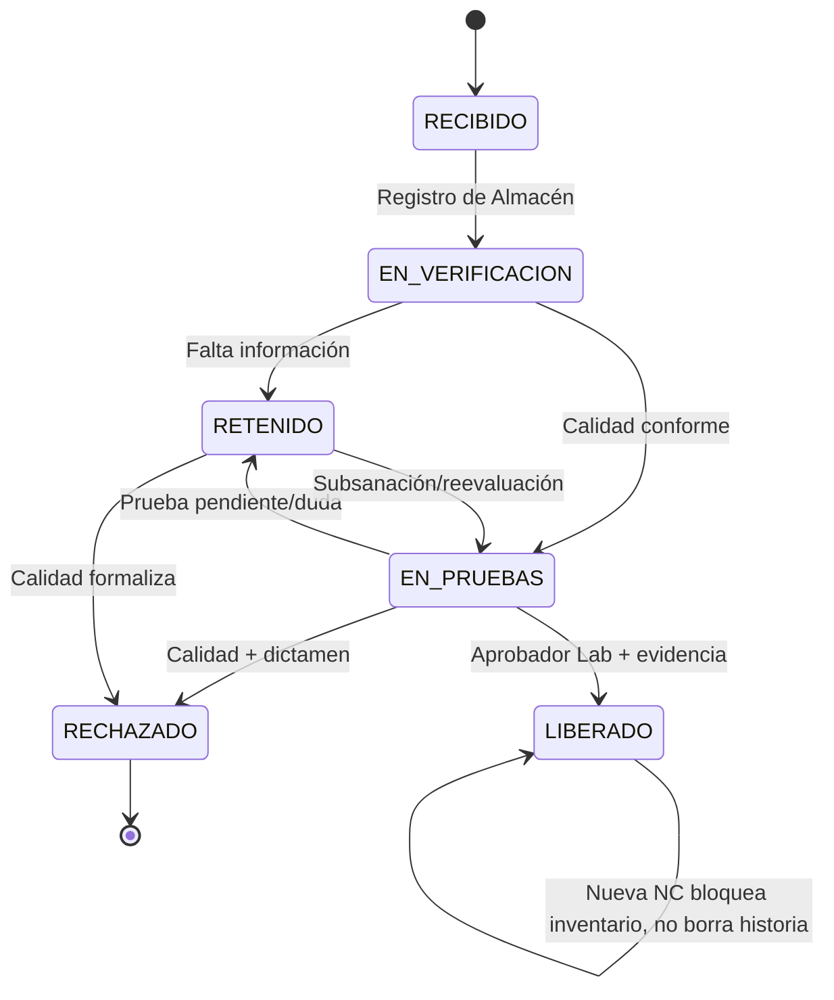
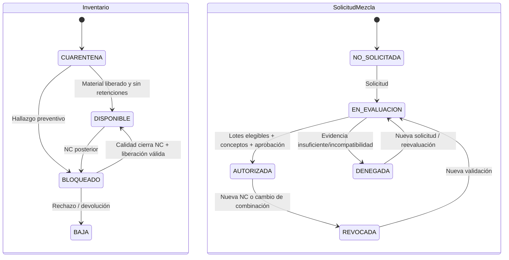
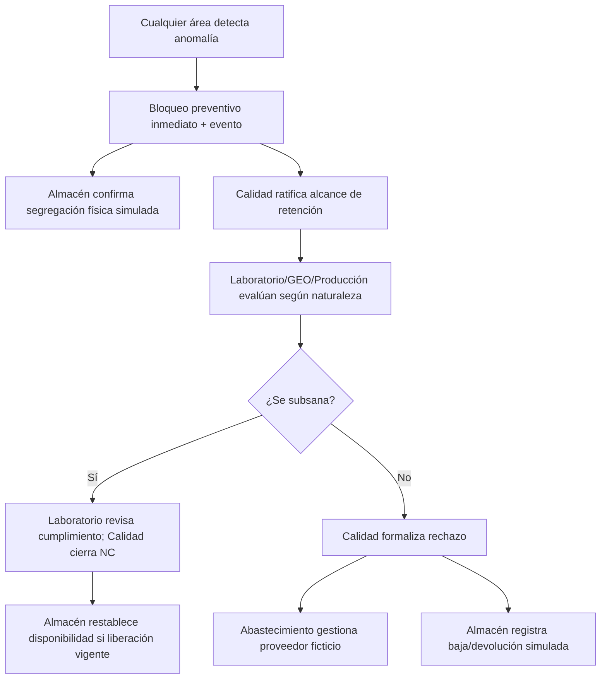
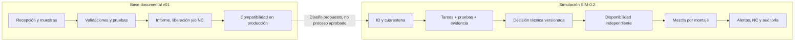
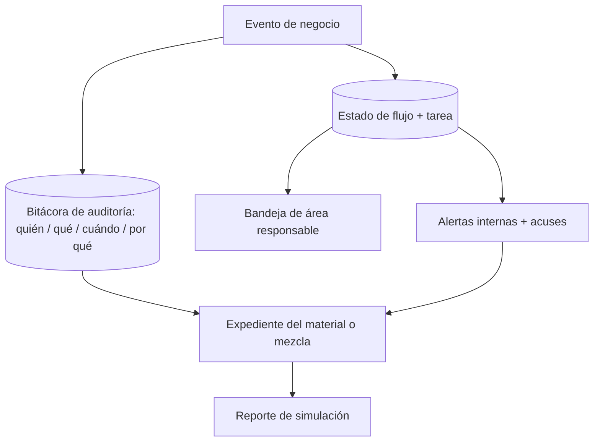

# PROCO — Diagramas de simulación SIM-0.2

**Borrador para simulación — no proceso operativo aprobado.**
Todos los flujos incluyen reglas [P] propuestas. Los esquemas expresan decisiones de negocio; Mermaid no es un motor de ejecución de BPMN. Los estados de material, inventario y mezcla deben persistirse por separado.

## D1. Proceso multiactor de extremo a extremo



## D2. Estados técnicos del material



## D3. Estados independientes de disponibilidad y mezcla



## D4. Matriz de autoridad como flujo de bloqueo y rechazo



## D5. Secuencia de autorización de mezcla

```mermaid
sequenceDiagram
 actor T as Tejeduría
 participant S as Simulador
 actor L as Laboratorio
 actor G as GEO
 actor TI as Tintorería
 actor P as Producción (aprobador)
 T->>S: Solicita mezcla(lotes, cantidades, montaje)
 S->>S: Verifica calidad, disponibilidad, trazabilidad
 alt Algún lote no elegible
   S-->>T: 422: mezcla no solicitada; motivo
 else Lotes elegibles
   S->>L: Solicita concepto / ensayos
   S->>G: Solicita concepto operacional
   opt Riesgo tintóreo
     S->>TI: Solicita concepto tintóreo
   end
   L-->>S: Concepto técnico
   G-->>S: Concepto operacional
   TI-->>S: Concepto tintóreo cuando corresponda
   S->>P: Tarea de aprobación
   P->>S: Autoriza o deniega con motivo
   S-->>T: Resultado y evidencia, ligado a montaje
 end
```

## D6. AS-IS documental frente al simulador TO-BE



## D7. Notificaciones y datos de trazabilidad


